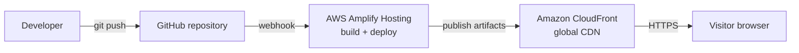

# Aqib Hussain — Portfolio (Builder Lab)

A fast, accessible, responsive developer portfolio for **Aqib Hussain**, a Computer Engineering student focused on AWS, Linux, containers and DevOps. It is hosted on **AWS Amplify Hosting** and ships automatically on every push to GitHub.

**Live site:** `https://<your-amplify-domain>.amplifyapp.com` *(replace with your URL)*
**Source:** https://github.com/rana2742/portfoilo-aqib-husain *(confirm the repo name)*

---

## The creative feature: Builder Lab terminal

Instead of a static "about" page, visitors can *talk to the portfolio*. A working command-line terminal sits in the page, and it is hinted three ways so nobody misses it: a pulsing banner in the hero, a "Terminal · 4 secrets" link in the navigation, and a counter inside the terminal itself.

It is built around DevOps habits rather than gimmicks:

| Try this | What happens |
| --- | --- |
| `deploy` | Replays a CI/CD pipeline (GitHub → Amplify → CloudFront) and ends with "this page shipped through exactly this pipeline" |
| `aws` | Documents the AWS services behind the site |
| `theme neon` / `dark` / `pastel` / `paper` | Re-skins the whole website live; the choice is remembered |
| `goto work` | The terminal scrolls the real page to that section |
| `ls -a`, `cat .hidden` | A tiny file system with a hidden file that points at more secrets |
| `Up/Down`, `Tab`, `Ctrl+L` | Command history, autocomplete, clear, like a real shell |
| `secret` and 3 more | **4 hidden secrets** with a live `SECRETS 0/4` counter. Finding all four lights up the terminal |

Everything else stays easy to use: normal navigation, no popups, nothing blocks scrolling, and the terminal is fully optional.

### Terminal design notes
- Output is written with `textContent`, so nothing typed can inject HTML.
- The output region is an ARIA live log, so screen readers announce results.
- Animations respect `prefers-reduced-motion`.
- Works with keyboard only; the input uses 16px text on mobile to avoid iOS zoom.

---

## Portfolio sections

1. **About me**: Computer Engineering at Bahauddin Zakariya University, Multan, Pakistan.
2. **Skills (technical workbench)**: AWS, Linux, containers, delivery automation, infrastructure.
3. **Projects**: six real projects with live demos or source (ERP, School Management, Business Management, Khan Mobile Shop, AI Personal Finance Assistant, Wanderlust on Minikube).
4. **Journey**: AWS Student Builder Group technical lead, instructor at Bitops Technologies Community, AWS GameDay winning participant.
5. **Builder Lab terminal** (creative feature) and **How this site ships** (AWS architecture on the page).

---

## AWS architecture



### AWS services used

| Service | Role in this project |
| --- | --- |
| **AWS Amplify Hosting** | Connects to the GitHub repo, runs the build defined in `amplify.yml`, and redeploys automatically on every push to the main branch |
| **Amazon CloudFront** (managed by Amplify) | Serves the site from a global CDN edge network for low latency |
| **HTTPS / managed certificate** (managed by Amplify) | The site is served over HTTPS on the default Amplify domain |

**Why a static site?** It has no servers to patch, loads quickly, and costs almost nothing to host. A backend, database or API is intentionally not part of this architecture.

### Configuration files
- `amplify.yml`: build spec. There is no compile step, so the repository root is published as-is.
- `customHttp.yml`: custom response headers applied by Amplify (HSTS, `X-Content-Type-Options`, `X-Frame-Options`, `Referrer-Policy`, `Permissions-Policy`, and image caching).

---

## Screenshots

> Add your own screenshots to `docs/screenshots/` using these names. The write-up in `SUBMISSION.md` references them.

| Screenshot | File |
| --- | --- |
| Home page, desktop | `docs/screenshots/home-desktop.png` |
| Home page, mobile | `docs/screenshots/home-mobile.png` |
| Terminal after `secret` / `deploy` | `docs/screenshots/terminal.png` |
| Neon theme | `docs/screenshots/theme-neon.png` |
| Amplify app overview | `docs/screenshots/amplify-app.png` |
| Amplify deployment status (success) | `docs/screenshots/amplify-deploy.png` |

---

## Run locally

No framework, package manager or build step.

```bash
git clone https://github.com/rana2742/portfoilo-aqib-husain.git
cd portfoilo-aqib-husain
# open index.html in a browser, or serve it:
python3 -m http.server 8080   # then visit http://localhost:8080
```

## Deploy to AWS Amplify Hosting

1. Push this repository to GitHub.
2. In the AWS Console open **AWS Amplify → Create new app → Host web app → GitHub**.
3. Authorize GitHub, choose the repository and the `main` branch.
4. Keep the detected build settings (`amplify.yml`) and click **Save and deploy**.
5. Open the generated `*.amplifyapp.com` URL and test on desktop and mobile.

## Project structure

```
index.html       page structure and content
styles.css       base design
extras.css       themes, legibility pass, new components
script.js        navigation, theme switcher, terminal engine
amplify.yml      Amplify build spec
customHttp.yml   Amplify custom headers
images/          project screenshots
```

## What I learned

- How Amplify Hosting turns a `git push` into a global deployment, and how CloudFront sits behind it.
- Linux hosting is **case-sensitive**: an image named `ERP.png` on Windows must be referenced exactly in the HTML or it breaks after deployment.
- Designing one codebase for several themes by using CSS custom properties instead of hard-coded colors.
- Accessibility basics for interactive widgets: live regions, keyboard support, focus styles and reduced motion.

## Credits and attribution

- The **Wanderlust Deployment** card links to my deployment work on the open-source Wanderlust project; the application itself belongs to its upstream authors.
- Skills listed reflect current learning and hands-on practice, not formal certification levels.
- Fonts: DM Mono, Space Grotesk and Manrope via Google Fonts.
